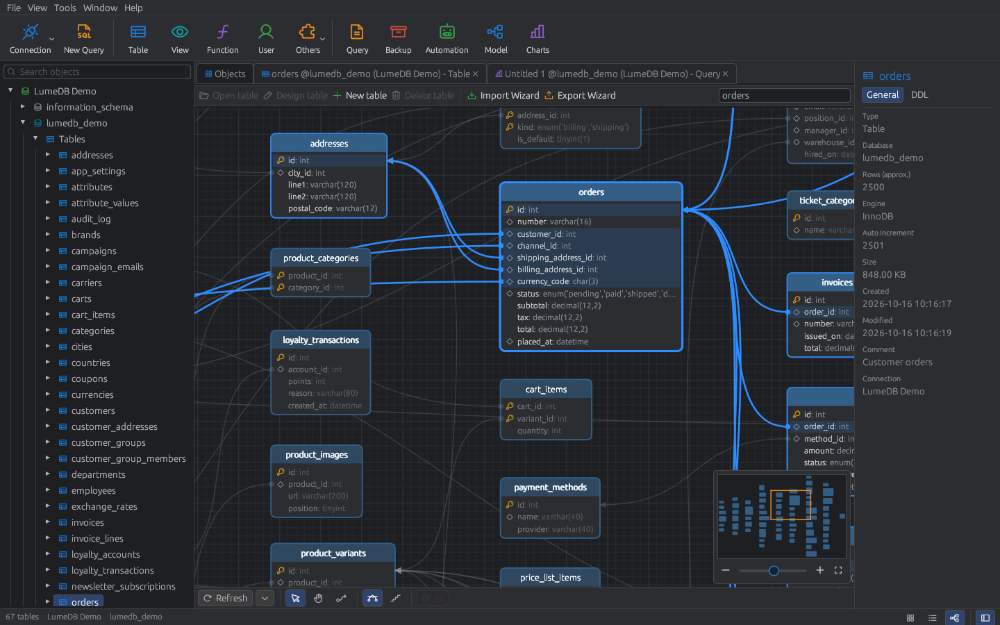
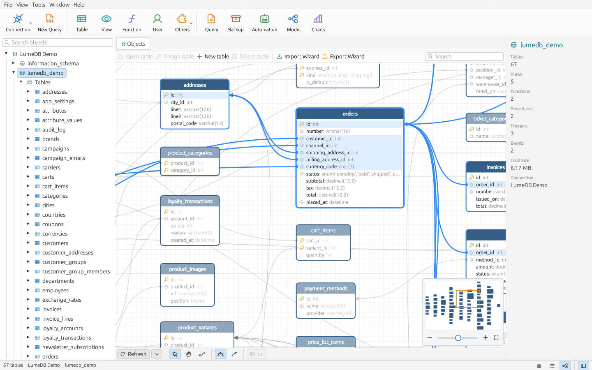
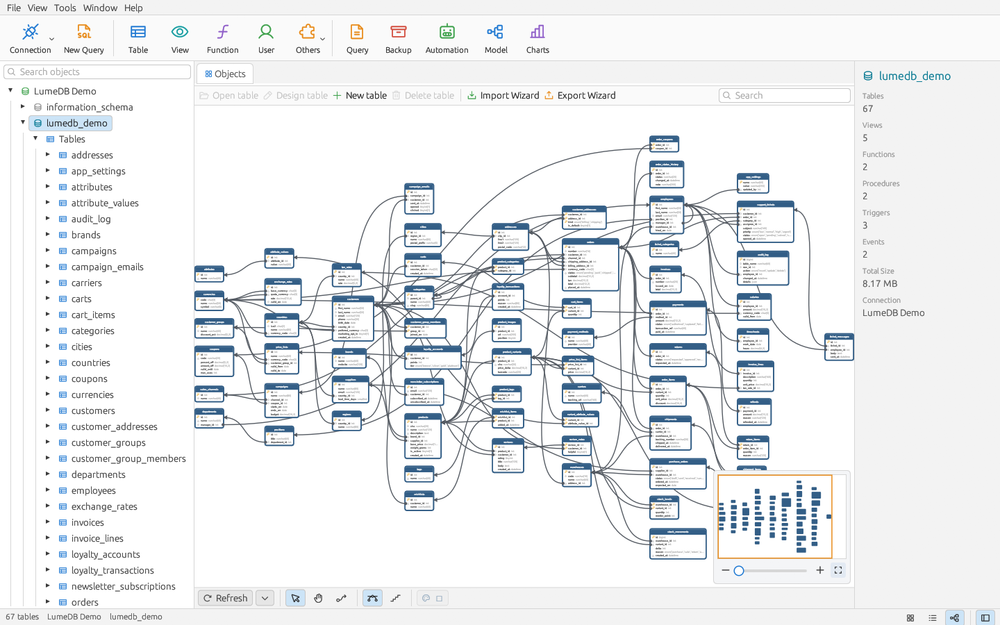
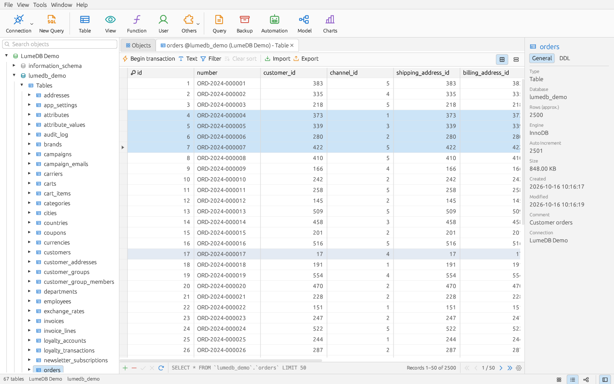
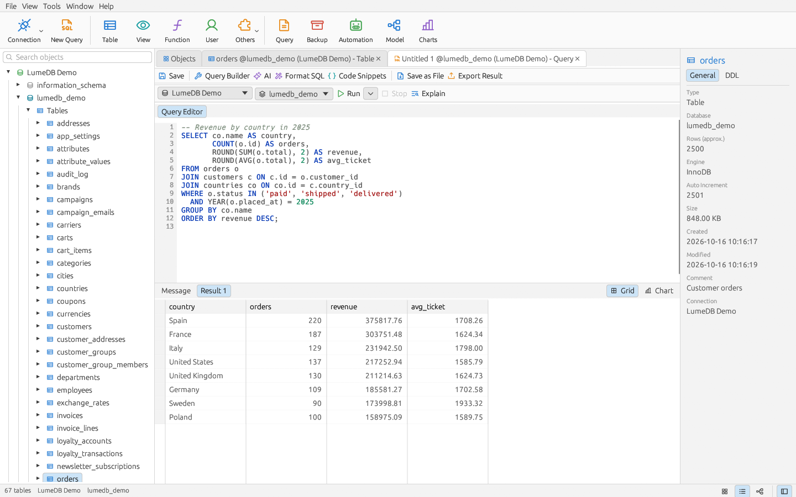
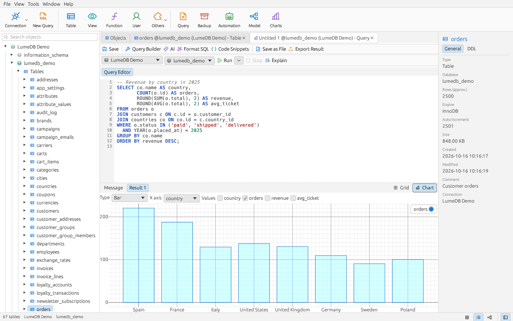
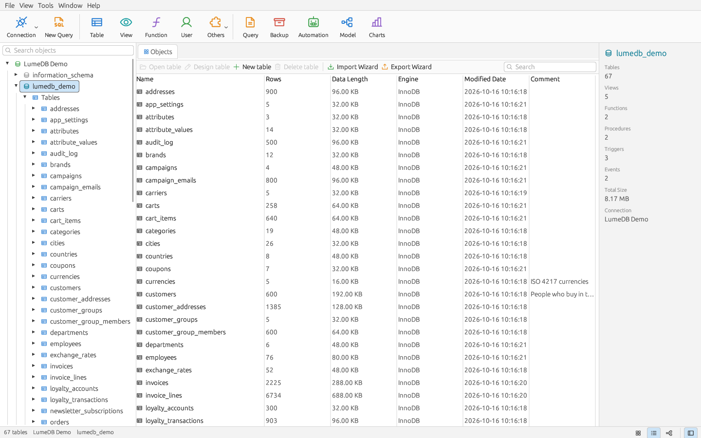

<div align="center">


# LumeDB

**A fast, native database client for MySQL, PostgreSQL and SQLite — written in Rust.**

Browse, edit, query and model your databases in one desktop app,<br>
with a familiar workflow, an ER diagram that actually reads well, and SQL written by AI from a comment.

[](https://github.com/ricardoalmira89/lumedb/actions/workflows/ci.yml)
[](#license)


**English** · [Español](README.es.md)



</div>

---

## Why LumeDB

- **Native and light.** A single Rust binary built on [egui](https://github.com/emilk/egui). It starts instantly and keeps every connection on its own thread, so a slow query never freezes the window.
- **A workflow you already know.** Navigation tree on the left, objects and tabs in the middle, details on the right, a ribbon toolbar on top. If you have used a classic database GUI, you are at home.
- **ER diagrams you can read.** Relations are drawn as curves from the exact source column to the exact target column. Hover a table to light up everything it touches, and let auto-layout untangle schemas with dozens of tables.
- **AI where it helps.** Write `-- top 10 customers by revenue this year` and press <kbd>Ctrl</kbd>+<kbd>Enter</kbd>: LumeDB sends your schema to Claude or OpenAI and writes the SQL for you.
- **Your passwords stay safe.** Credentials and API keys live in the system keyring, never in plain-text config files.

## Screenshots

<table>
  <tr>
    <td width="50%"><br><sub><b>ER diagram</b> — curved column-to-column links and hover highlight</sub></td>
    <td width="50%"><br><sub><b>Auto-layout</b> — 67 tables and 96 foreign keys on one screen</sub></td>
  </tr>
  <tr>
    <td><br><sub><b>Data grid</b> — click-to-edit cells, multi-row selection, foreign key picker</sub></td>
    <td><br><sub><b>SQL editor</b> — highlighting, autocompletion and multiple result sets</sub></td>
  </tr>
  <tr>
    <td><br><sub><b>Charts</b> — turn any result into a bar, line, area, scatter or pie chart</sub></td>
    <td><br><sub><b>Objects</b> — rows, size, engine and comments for every table</sub></td>
  </tr>
</table>

## Features

<details open>
<summary><b>Connections</b></summary>

- PostgreSQL, MySQL / MariaDB and SQLite.
- SSL (custom CA, optional verification) and SSH tunnels (password or private key).
- Groups (folders) and colours; duplicate, edit and test connections.
- Passwords in the system keyring, with an optional "ask every time" mode.
- Import connections from Navicat `.ncx` files, including passwords and SSH settings.
</details>

<details open>
<summary><b>Browsing and editing data</b></summary>

- Tree of connections → databases → schemas → tables, views, functions, procedures, triggers, sequences and events, plus saved queries and backups.
- Expand any table to see its fields, indexes, foreign keys, checks and triggers.
- Editable grid: single-click editing, NULL / empty string, long-text editor, add and delete rows (with confirmation), apply or discard changes.
- Shift/Ctrl multi-row selection and <kbd>Ctrl</kbd>+<kbd>C</kbd> to copy rows as tab-separated text.
- Foreign key picker: choose a value from the referenced table instead of typing an id.
- Manual transactions, WHERE filter, sorting, pagination (records per page configurable) and form view.
</details>

<details open>
<summary><b>Queries</b></summary>

- Syntax highlighting, line numbers and autocompletion of keywords, tables, columns and `alias.column`.
- Run everything, the selection or the statement under the cursor; stop a running query; Explain; format SQL.
- Several result sets per run, charts, export of results.
- Visual query builder with drag-and-drop joins.
- Saved queries, query history and code snippets.
- **AI SQL generation** with Claude or OpenAI, using the real schema of your database.
</details>

<details open>
<summary><b>Design and modelling</b></summary>

- Table designer: fields, indexes, foreign keys, options and live SQL preview (`CREATE` / `ALTER`, with a safe table rebuild on SQLite).
- Editors for views, functions, procedures, triggers, events and sequences, with templates per engine.
- ER diagram of any schema: minimap, zoom, auto-layout, curved or orthogonal links, colours, and drawing new relations with the mouse.
</details>

<details open>
<summary><b>Tools</b></summary>

- Import from CSV, TXT, JSON and Excel with column mapping; export to CSV, TXT, JSON, XML, HTML, Markdown, SQL and Excel.
- SQL dumps and SQL file execution; compressed backups with restore.
- Data transfer between connections (also across engines), data synchronization and structure synchronization.
- Users and privileges, server monitor (processes, variables, status), find in database, test data generation, console.
- Scheduled automation jobs, also runnable from cron: `lumedb --run-job "name"`.
- English and Spanish interface; light and dark theme.
</details>

## Getting started

LumeDB is in **alpha**: it is developed and tested on Linux; expect rough edges, and keep backups of anything important.

### Download

Get the latest build from the [**Releases**](https://github.com/ricardoalmira89/lumedb/releases) page:

| Platform | Package |
|---|---|
| Windows 10/11 | `lumedb-…-windows-x86_64.zip` — unzip and run `lumedb.exe` |
| macOS (Apple Silicon / Intel) | `lumedb-…-macos-aarch64.zip` / `lumedb-…-macos-x86_64.zip` |
| Debian / Ubuntu | `lumedb_…_amd64.deb` — `sudo apt install ./lumedb_…_amd64.deb` |
| Other Linux | `lumedb-…-linux-x86_64.tar.gz` |

The builds are not signed yet: on macOS, open the app the first time with right-click → **Open**; on Windows, SmartScreen may ask you to confirm with **More info → Run anyway**.

### Build from source

#### 1. Install Rust

Use [rustup](https://rustup.rs) to get the latest stable toolchain.

#### 2. Install the system libraries

<details>
<summary>Debian / Ubuntu</summary>

```sh
sudo apt install build-essential pkg-config libssl-dev libdbus-1-dev libgtk-3-dev \
  libxcb-render0-dev libxcb-shape0-dev libxcb-xfixes0-dev libxkbcommon-dev
```
</details>

<details>
<summary>Fedora</summary>

```sh
sudo dnf install gcc pkgconf-pkg-config openssl-devel dbus-devel gtk3-devel libxkbcommon-devel
```
</details>

<details>
<summary>macOS and Windows</summary>

No extra system libraries should be needed, but LumeDB has not been built or tested on these platforms yet. Reports and fixes are very welcome.
</details>

#### 3. Build and run

```sh
git clone https://github.com/ricardoalmira89/lumedb.git
cd lumedb
cargo run --release
```

The binary is `target/release/lumedb`. On Linux, copy it somewhere in your `PATH` and install `assets/lumedb.desktop` and `assets/lumedb.svg` to add LumeDB to your application launcher:

```sh
install -Dm755 target/release/lumedb ~/.local/bin/lumedb
install -Dm644 assets/lumedb.desktop ~/.local/share/applications/lumedb.desktop
install -Dm644 assets/lumedb.svg ~/.local/share/icons/hicolor/scalable/apps/lumedb.svg
```

### Try it with the demo database

`examples/demo` generates an invented online store — 67 tables, 96 foreign keys, views, routines, triggers and events — perfect for exploring LumeDB (it is the database in the screenshots):

```sh
docker run -d --name lumedb-demo-mysql -e MYSQL_ROOT_PASSWORD=lumedb \
  -p 127.0.0.1:33310:3306 mysql:latest
python3 examples/demo/generate.py > examples/demo/lumedb_demo.mysql.sql
docker exec -i lumedb-demo-mysql mysql -uroot -plumedb < examples/demo/lumedb_demo.mysql.sql
```

Then add a MySQL connection to `127.0.0.1:33310` (user `root`, password `lumedb`, database `lumedb_demo`).

## Keyboard shortcuts

| Shortcut | Action |
|---|---|
| <kbd>Ctrl</kbd>+<kbd>Q</kbd> | New query |
| <kbd>Ctrl</kbd>+<kbd>R</kbd> | Run the query (or the selection) |
| <kbd>Ctrl</kbd>+<kbd>Shift</kbd>+<kbd>R</kbd> | Run the statement under the cursor |
| <kbd>Ctrl</kbd>+<kbd>Enter</kbd> | Generate SQL from the comment under the cursor (AI), or run |
| <kbd>Ctrl</kbd>+<kbd>Space</kbd> | Autocomplete |
| <kbd>Ctrl</kbd>+<kbd>S</kbd> | Apply the pending changes of a table / save |
| <kbd>Delete</kbd> | Delete the selected records (asks first) |
| <kbd>Ctrl</kbd>+<kbd>W</kbd> | Close the tab |
| <kbd>Ctrl</kbd>+wheel | Zoom the ER diagram |

## AI assistant

Open **Tools → AI Assistant…**, pick **Claude (Anthropic)** or **OpenAI** and paste your API key (or set `ANTHROPIC_API_KEY` / `OPENAI_API_KEY`). In the query editor, write what you need as a comment and press <kbd>Ctrl</kbd>+<kbd>Enter</kbd>:

```sql
-- customers from Spain with more than 3 orders, newest first
```

LumeDB sends the table and column names of the current schema — never your data — and inserts the generated SQL below the comment, ready to review and run.

## Security and privacy

- Passwords, SSH secrets and API keys are stored in the OS keyring (Secret Service on Linux, Keychain on macOS, Credential Manager on Windows).
- Without a keyring, or with `LUMEDB_NO_KEYRING=1`, saved secrets are kept in config files readable only by your user (`0600`), and LumeDB tells you so.
- No telemetry. The only network traffic is to your databases and, if you use it, to the AI provider you configured.

## Project layout

```
crates/
  lumedb-core/   connections (SSL/SSH), drivers, metadata, DDL, editing, SQL tools,
                 import/export, dump, sync, admin, automation, keyring, translations
  lumedb-app/    the egui desktop app: one worker thread per connection,
                 every tab and window is a `View` in views/
examples/demo/   generator of the demo database
assets/          logo, icons and desktop entry
```

## Development

```sh
cargo test                          # SQLite and unit tests
LUMEDB_TEST_LIVE=1 cargo test       # also PostgreSQL (port 55432) and MySQL (33306), password "lumedb"
LUMEDB_TEST_KEYRING=1 cargo test    # also the system keyring (needs an unlocked keyring)
```

Containers for the live tests:

```sh
docker run -d --name lumedb-test-pg -e POSTGRES_PASSWORD=lumedb -p 127.0.0.1:55432:5432 postgres:16-alpine
docker run -d --name lumedb-test-mysql -e MYSQL_ROOT_PASSWORD=lumedb -p 127.0.0.1:33306:3306 mysql:latest
```

### Translations

English is the source language: interface strings are written in English inside `tr("…")` or `trf!("… {name} …", name = value)`. Translations live in `crates/lumedb-core/i18n/<lang>.json` as a map from the English text to the translation; missing entries fall back to English. To add a language, add a catalog and a variant to `Lang` in `crates/lumedb-core/src/i18n.rs`.

## Roadmap

- Prebuilt packages (AppImage / .deb, Windows installer, macOS app).
- More engines: SQL Server, Oracle, MongoDB, Redis.
- A full logical/physical model designer (today the ER diagram reflects an existing database).
- Function debugger and reports.

## Clean-room policy

LumeDB is an independent implementation. Its interface follows the general layout of classic database GUIs such as Navicat, but:

1. No third-party application is decompiled or disassembled, and none of its code, icons, texts or translations are copied.
2. Features are reimplemented from documentation and from observing normal use, which is allowed (EU Directive 2009/24/EC, art. 5.3; CJEU C-406/10, *SAS Institute*).
3. Interoperability with Navicat files (`.ncx` connection import) is based on public documentation and our own sample files.

Contributions must follow the same rules. LumeDB is not affiliated with, endorsed by or sponsored by PremiumSoft CyberTech Ltd. Navicat is a trademark of its respective owner.

## License

Licensed under either of

- Apache License, Version 2.0 ([LICENSE-APACHE](LICENSE-APACHE))
- MIT license ([LICENSE-MIT](LICENSE-MIT))

at your option. Unless you explicitly state otherwise, any contribution you submit for inclusion in LumeDB shall be dual licensed as above, without any additional terms or conditions.
